# Result visualizations

Figures of the experiment results recorded in [`docs/journal/`](../journal/) and
[`docs/data/`](../data/), one per question. Every number is read from a `docs/data` file at
plot time; the only constants typed into the scripts are published figures quoted by an entry
(UB's GET band, bytes per glibc loop trip) and are named where they are used. Each figure carries
its data files and journal entry in its own caption.

Regenerate all figures (overwrites `svg/`):

```sh
make viz            # = python3 docs/viz/make.py
```

Tooling: Python 3.12.2, matplotlib 3.8.4, pandas 2.2.2. Nothing else. SVG output is
deterministic (`svg.hashsalt` fixed, no date metadata, text kept as text): regenerating gives
byte-identical files.

Platform caveat for every figure: M1/HVF guest on a shared, noisy host. Ratios and spreads are
meaningful, absolute numbers are not hardware numbers. Dots are single runs, boots or pairs
(whatever the caption says); lines or bars are medians.

Colour: the dataviz reference categorical palette in its fixed slot order (validated:
all hard gates pass; three light slots are below 3:1 contrast, so every series has a legend or
direct label, and the numbers are in the data files). Series beyond three in scatter-like
panels also differ by marker shape.

## Index

### 1. Redis under UB's benchmark protocol

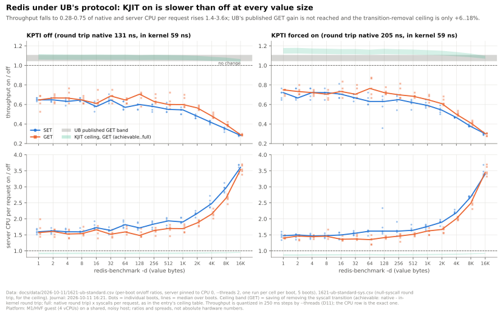

KJIT on is slower than off at every value size, SET and GET, KPTI off and on: throughput 0.28-0.75
of off, server CPU 1.4-3.6x, against UB's published GET +4.4..10.8% and a transition-removal ceiling
of +5..18%. Entry: 2026-10-11 16:21. Data: `2026-10-11/1621-ub-standard.csv`, `1621-ub-standard-sys.csv`.

### 2. PAN ablation across value sizes

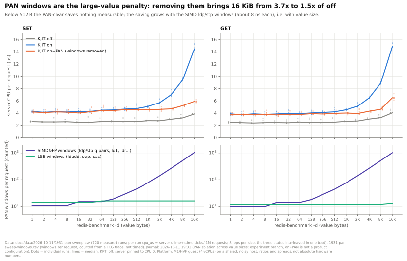

The PAN windows explain the large-value penalty: clearing PAN for the run takes 16 KiB from 3.7x to
1.5x of off, buys nothing below 512 B; windows per request grow from 25 to about 1000, all SIMD ldp/stp.
Entry: 2026-10-11 19:31 (PAN ablation). Data: `1931-pan-sweep.csv`, `1931-pan-sweep-windows.csv`.

### 3. Redis CPU gap by setup

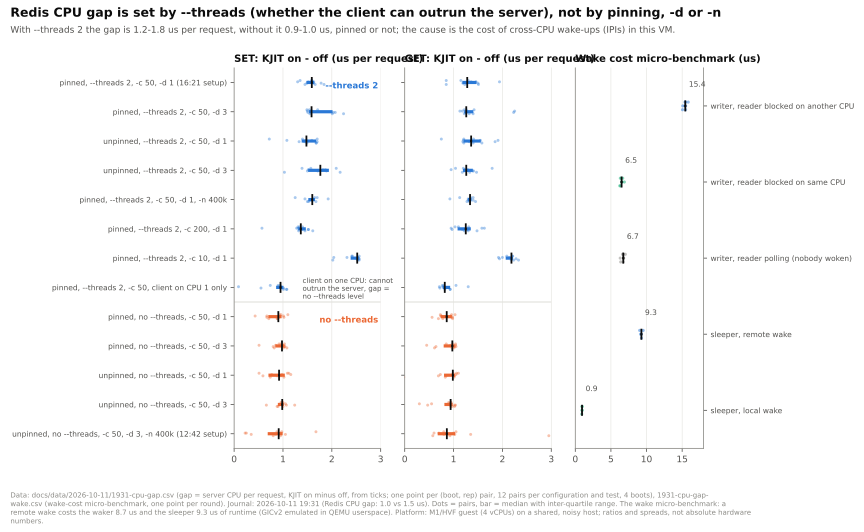

`--threads` is the factor: the on-off gap is 1.2-1.8 us per request with `--threads 2` and 0.9-1.0 us
without, pinned or not, any `-d`, any `-n`; a remote wake costs 8.7 us of the waker in this VM (GICv2
in QEMU userspace). Entry: 2026-10-11 19:31 (Redis CPU gap). Data: `1931-cpu-gap.csv`, `1931-cpu-gap-wake.csv`.

### 4. Translated code speed across versions

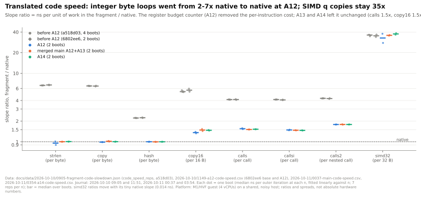

Integer byte loops went from 2-7x native to native at A12 (budget counter in x18); A13 and A14 left
the slopes unchanged; calls stay 1.5x, copy16 1.5x, simd32 35x. Entries: 2026-10-10 09:05 and 11:51,
2026-10-11 00:37 and 03:54. Data: `2026-10-10/0905-fragment-code-slowdown.json`, `1149-a12-code-speed.csv`,
`2026-10-11/0037-main-code-speed.csv`, `0354-a14-code-speed.csv`.

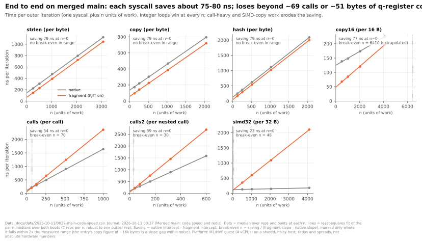

End to end on merged main: every syscall that resumes in a fragment saves 75-80 ns; integer loops win at
every n, calls break even at about 70 calls and 30 nested calls, q-register copies at about 50 bytes.
Entry: 2026-10-11 00:37. Data: `0037-main-code-speed.csv`.

### 5. Dispatch stall = I-cache placement

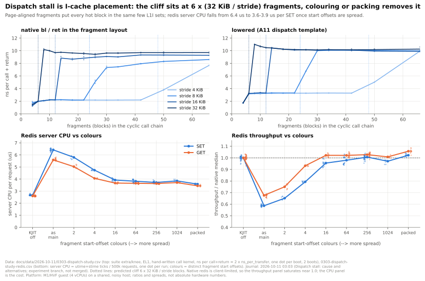

The cliff sits at 6 x (32 KiB / stride) fragments; spreading fragment start offsets (16 colours or more)
or packing takes redis SET from 6.4 to 3.6-3.9 us of server CPU per request. Entry: 2026-10-11 03:03.
Data: `0303-dispatch-study.csv`, `0303-dispatch-study-redis.csv`.

### 6. Redis loss attribution before and after A14

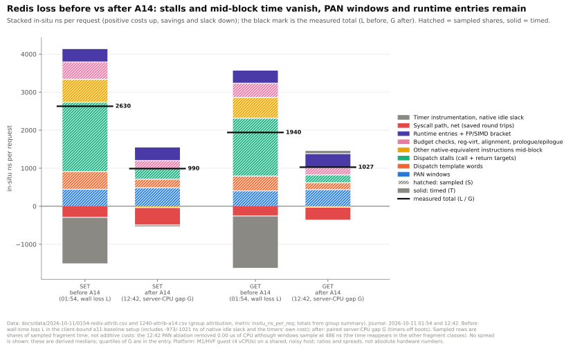

A14 removes the dispatch-stall and mid-block rows; PAN windows, dispatch template words and runtime entries
remain. Hatched rows are sampled shares (not additive: removing the windows removed 0.00 us of CPU although
486 ns are sampled on them), solid rows are timed. Before is a wall-time loss (client-bound setup, includes
the native idle slack), after is a paired server-CPU gap. Entries: 2026-10-11 01:54 and 12:42.
Data: `0154-redis-attrib.csv`, `1240-attrib-a14.csv`.

### 7. SIMD&FP lowering alternatives

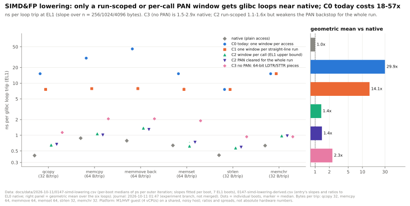

One window per access (today, C0) costs 18-57x native per glibc loop trip, one per straight-line run
(C1) 9-24x, no-PAN LDTR/STTR pieces (C3) 1.5-2.9x, a per-call or run-scoped window 1.1-1.6x (the run-scoped
one weakens the PAN backstop for the whole run). Entry: 2026-10-11 01:47.
Data: `0147-simd-lowering.csv`, `0147-simd-lowering-derived.csv`.

### 8. Variant studies

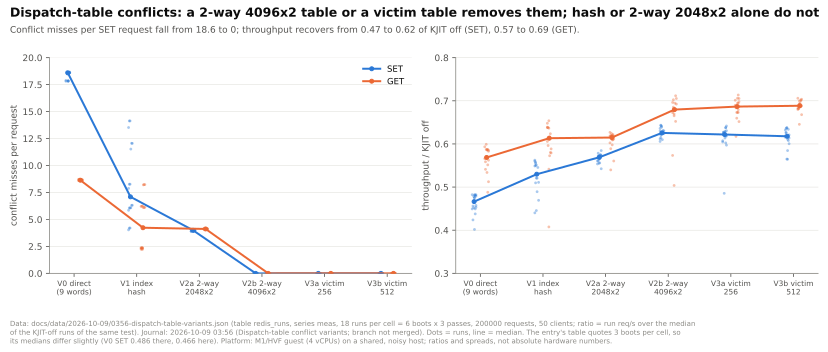

Dispatch-table conflicts: only the 2-way 4096x2 table and the victim tables remove the conflict misses;
hash and 2-way 2048x2 do not. Entry: 2026-10-09 03:56. Data: `2026-10-09/0356-dispatch-table-variants.json`.

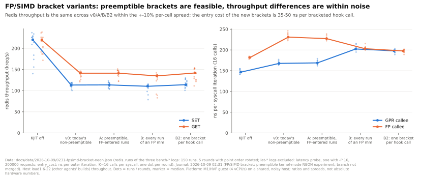

FP/SIMD bracket variants: throughput is the same across v0, A, B and B2 within the spread; the new brackets
cost 35-50 ns per bracketed hook call. Entry: 2026-10-09 02:31. Data: `0231-fpsimd-bracket-neon.json`.

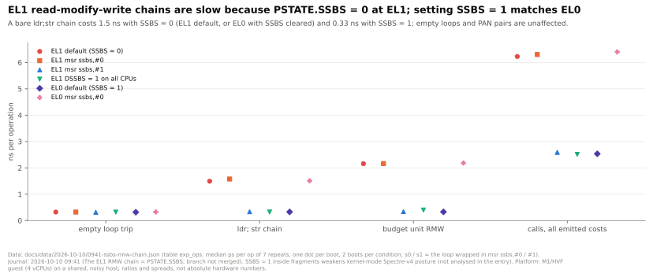

The EL1 RMW-chain cost is PSTATE.SSBS = 0: with SSBS = 1 an `ldr; str` chain costs 0.33 ns instead of 1.5 ns,
at EL1 as at EL0. Entry: 2026-10-10 09:41. Data: `2026-10-10/0941-ssbs-rmw-chain.json`.

### 9. Progress overview

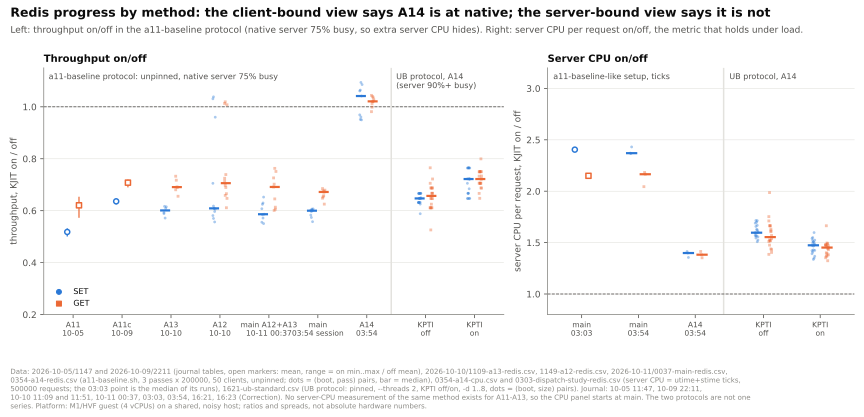

Two methods, kept apart (see the 16:23 correction): the a11-baseline protocol (unpinned client, native server
75% busy) shows throughput on/off rising from 0.52 (A11) to 1.0 at A14, which hides the server cost; the
server-CPU view (a11-baseline-like setup, ticks) falls from 2.4x (main) to 1.4x (A14), and A14 under the UB
protocol is 1.5-1.6x CPU, 0.65-0.72 throughput. No server-CPU measurement of the same method exists for A11-A13,
so that series starts at main. Entries: 2026-10-05 11:47, 2026-10-09 22:11, 2026-10-10 11:09 and 11:51,
2026-10-11 00:37, 03:03, 03:54, 16:21, 16:23. Data: see the caption of the figure.

## Notes on the data

- Fits (fig 4): lines are least squares on the per-n median over reps. A pooled fit over all reps is skewed
  by one outlier rep (main `hash` n=1024, KJIT on: 1569 ns against 1021) and moves the `hash` saving from 79 to 76 ns.
- Fig 8a: the data file holds 6 boots (18 runs per cell); the entry's table quotes the first 3 boots (9 runs), so
  its medians differ slightly (V0 SET 0.486 there, 0.466 here).
- Fig 8b: `redis_runs` also holds the `lat-*` logs (latency probe, one with `-P 16`); only the `bench-*` logs are
  throughput runs and only they are plotted (their medians equal the entry's table).
- Fig 6: the two attribution files tag rows differently (`measured(sampled)`/`measured` in 01:54,
  `sampled`/`timed`/`measured` in 12:42) and name the share column differently; the script maps both.
